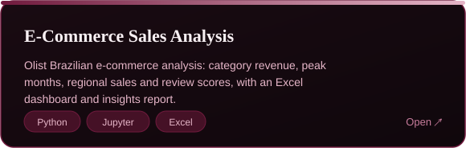
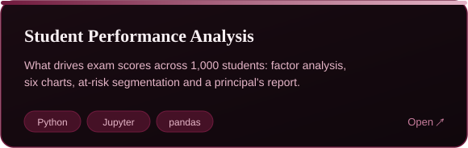
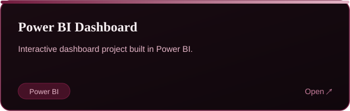
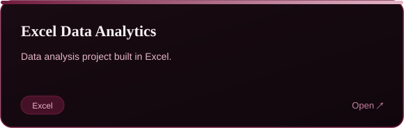
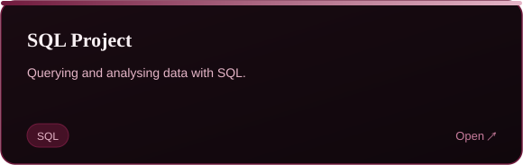
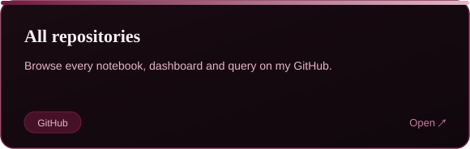
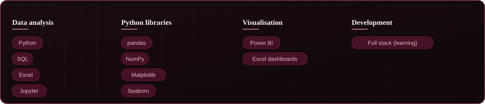

I'm Madhav, a final-year student working in **data analytics** and growing into **full stack development**. I like turning raw datasets into clear findings, and I'm building the web skills to ship the tools around them. I'm looking for an industry role where I can analyse data, build things that work, and keep learning with a team.

<table>
<tr>
<td width="50%"></td>
<td width="50%"></td>
</tr>
<tr>
<td width="50%"></td>
<td width="50%"></td>
</tr>
<tr>
<td width="50%"></td>
<td width="50%"></td>
</tr>
</table>

**Open a project to see what I found:**

<b>E-Commerce Sales Analysis — key findings</b>

 

From the Olist Brazilian e-commerce dataset (delivered orders only):

- **Top category by revenue:** Health & Beauty
- **Peak month:** November 2017, consistent with a Black Friday effect
- **Best region:** São Paulo (SP)
- **Average order value:** flat at about R$150–175, so growth came from order volume, not bigger baskets
- **Reviews:** mostly positive, but about 12.8% of orders got 1–2 stars

[Read the full analysis →](https://github.com/madhav-insights/E-Commerce-Sales-Analysis)

<b>Student Performance Analysis — key takeaways</b>

 

From 1,000 student records:

- **Test preparation** is the strongest actionable lever and lifts scores in all three subjects
- **Lunch type and parental education** both correlate strongly with at-risk rates
- **Gender** shapes which subject a student excels in (math vs reading and writing) rather than overall risk

[Read the full analysis →](https://github.com/madhav-insights/Student-Performance-Analysis)

Live contribution data from GitHub.

<a href="#about">↑ Back to top</a>

